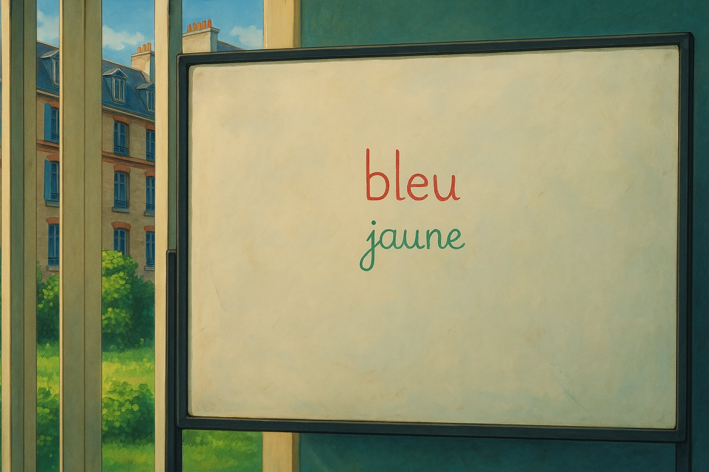

<Badge href="../storybook/" logo="storybook" color="storybook">Storybook</Badge>
<Badge href="https://ui.shadcn.com/docs/directory?q=pmndrs">
  <svg
    data-icon="inline-start"
    width="12"
    height="12"
    viewBox="0 0 256 256"
    fill="none"
    stroke="currentColor"
    strokeWidth="32"
    strokeLinecap="round"
    strokeLinejoin="round"
    aria-hidden="true"
  >
    <path d="M208 128l-80 80M192 40L40 192" />
  </svg>
  <span>shadcn/ui</span>
</Badge>

<Intro>
  A shared visual language for pmndrs: colours, typography, spacing, radius,
  shadows and motion. Guidelines, tokens and assets carry it across tools and
  platforms. A [shadcn registry](https://ui.shadcn.com/docs/registry) distributes
  code and files for individual integrations.
</Intro>



## Use the foundations

Choose the resources that fit your project:

- [Guidelines](/guidelines/introduction) describe how to use the visual language;
  [Colors](/colors/introduction) and [Typography](/typography/introduction)
  explain the foundations.
- For Figma, use the DTCG variable files:
  [Light](https://github.com/pmndrs/design-system/blob/main/figma/Light.tokens.json),
  [Dark](https://github.com/pmndrs/design-system/blob/main/figma/Dark.tokens.json) and
  [Foundations](https://github.com/pmndrs/design-system/blob/main/figma/Foundations.tokens.json).
  Import [Styles](https://github.com/pmndrs/design-system/blob/main/figma/Styles.tokens.json)
  through Tokens Studio for text and shadow styles.
- [Assets](/assets/introduction) previews the logo variants. Copy the
  [SVG files](https://github.com/pmndrs/design-system/tree/main/docs/assets)
  into your project or use them in your design tool.

## Registry items

The registry can host assets, vanilla JavaScript, Vue components and other
resources. Each item defines its files, dependencies and setup requirements.
Choose items that fit your project's environment. Browse the
[JSON index](https://pmndrs.github.io/design-system/r/registry.json) or read an
item directly, such as [`logo.json`](https://pmndrs.github.io/design-system/r/logo.json).

The registry is listed in the
[official shadcn registry directory](https://ui.shadcn.com/docs/directory?q=pmndrs).
The shadcn CLI automatically resolves `@pmndrs/<name>` to
`https://pmndrs.github.io/design-system/r/{name}.json`. The namespace is an
implicit alias: no `registry add` command or `registries` declaration in
`components.json` is needed. Browse, inspect or install resources directly:

```sh
npx shadcn@latest search @pmndrs
npx shadcn@latest view @pmndrs/logo
npx shadcn@latest add @pmndrs/logo @pmndrs/figma-tokens
```

The SVGs go in `public/pmndrs/`; the tokens go in `design/tokens/pmndrs/`.

For shadcn-vue, follow the [Vue setup](/getting-started/vue); its preset
configures the namespace.

### Catalog

Install addresses from this registry and other pmndrs repos. Use `add` for
resources; `preset` and `preset-vue` are `init` items. Each source link
documents its CLI and setup.

{/* catalog:start — generated by `npm run build`, edit scripts/catalog.mjs or registry/external.json instead */}

| Item | Install address |
| --- | --- |
| [md3-base](https://github.com/pmndrs/design-system/tree/main/registry/md3-base) | `@pmndrs/md3-base` |
| [font-mono](https://github.com/pmndrs/design-system/tree/main/registry/font-mono) | `@pmndrs/font-mono` |
| [theme](https://github.com/pmndrs/design-system/tree/main/registry/theme) | `@pmndrs/theme` |
| [palette](https://github.com/pmndrs/design-system/tree/main/registry/palette) | `@pmndrs/palette` |
| [preset](https://github.com/pmndrs/design-system/tree/main/registry/preset) | `@pmndrs/preset` |
| [preset-vue](https://github.com/pmndrs/design-system/tree/main/registry/preset-vue) | `@pmndrs/preset-vue` |
| [logo](https://github.com/pmndrs/design-system/tree/main/registry/logo) | `@pmndrs/logo` |
| [figma-tokens](https://github.com/pmndrs/design-system/tree/main/registry/figma-tokens) | `@pmndrs/figma-tokens` |
| [guidelines](https://github.com/pmndrs/design-system/tree/main/registry/guidelines) | `@pmndrs/guidelines` |
| [v0](https://github.com/pmndrs/design-system/tree/main/registry/v0) | `@pmndrs/v0` |
| [keypoints](https://github.com/pmndrs/docs/tree/v4.22.0/registry/keypoints) | `pmndrs/docs/keypoints#v4.22.0` |
| [color](https://github.com/pmndrs/docs/tree/v4.22.0/registry/color) | `pmndrs/docs/color#v4.22.0` |

To browse a specific release across repos:

```sh
npx shadcn@latest search pmndrs/design-system#v0.9.0 pmndrs/docs#v4.22.0
```

{/* catalog:end */}

## Versioning

The hosted `/r/` URLs and `@pmndrs` follow `main`. To install a specific release,
use a GitHub address with a tag:

```sh
npx shadcn@latest add pmndrs/design-system/logo#v0.9.0
```

Each dependency keeps its own ref. Installing from a branch preview does not
make its dependencies follow that branch.

## Next steps

To share a reusable item, [publish an item](/getting-started/publishing) from the
repo that owns it.

<span id="installation" />

Choose an integration guide for your app:

- [Vanilla HTML and CSS](/getting-started/vanilla): shared palette, fonts and native elements.
- [Vue](/getting-started/vue): preset, theme and components with shadcn-vue, or standard CSS.
- [React and Tailwind](/getting-started/react): preset, theme and components.

<details>
  <summary>Prototype in v0</summary>

For a prototype with the theme already applied,
[open in v0](https://v0.app/chat/api/open?url=https%3A%2F%2Fpmndrs.github.io%2Fdesign-system%2Fr%2Fv0.json&title=pmndrs).

Or generate the brand guidelines as slides:

[Open the brand guidelines as slides](https://v0.app/chat/api/open?url=https%3A%2F%2Fpmndrs.github.io%2Fdesign-system%2Fr%2Fv0.json&title=pmndrs+brand+guidelines&prompt=pmndrs+brand+guidelines%2C+16%3A9+slides%2C+strict+editorial+grid%2C+layout+inspired+by+https%3A%2F%2Fmir-s3-cdn-cf.behance.net%2Fprojects%2F808%2Fbc1589229031299.Y3JvcCwxNjgzLDEzMTYsMCww.jpg%2C+not+its+colours.+Follow+guidelines%2FGuidelines.md.+app%2Fglobals.css+is+the+palette%3A+never+edit%2C+no+hex%3B+brand+lime+%3D+bg-lime-container+%2B+text-on-lime-container.+Not+the+Poimandres+VS+Code+theme.+Light%2Fdark+toggle.+Cover%3A+%2Fpmndrs%2Flogo_complete.svg.+Then%3A+foreword%2C+logo%2C+colour%2C+type%2C+spacing%2C+radius%2C+icons%2C+components%2C+voice.).
The starter includes the theme, logo and `guidelines/Guidelines.md`.

</details>
